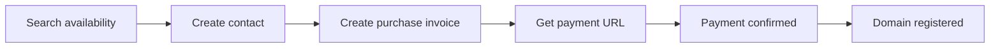

Search and catalog routes are public and need no key. Everything under `/cli/` needs a key scoped to `all`, `domain`, or `reselling`. Changes need `read_write`.

## Domain purchase flow



## Search domains

`POST /domains/search`

<ParamField body="query" type="string" required>
  Full domain or search term.
</ParamField>

<ParamField body="type" type="string">
  Optional TLD category.
</ParamField>

```bash
curl --request POST \
  https://server.pxxl.app/api/v3/domains/search \
  --header "Content-Type: application/json" \
  --data '{"query":"pxxl.cv"}'
```

```json
{
  "query": "pxxl.cv",
  "count": 1,
  "latency": 84,
  "cached": false,
  "results": [
    {
      "domain": "pxxl.cv",
      "available": true,
      "isPremium": false,
      "tld": ".cv",
      "registerDollar": 19,
      "registerNaira": 30000,
      "renewDollar": 19,
      "renewNaira": 30000,
      "minimumPeriod": 1,
      "maxDuration": 10
    }
  ]
}
```

### Search and catalog endpoints

| Method | Path | Parameters | Returns |
| --- | --- | --- | --- |
| `POST` | `/domains/search` | `query`, `type?` | `{ query, results, count, latency, cached }` |
| `POST` | `/domains/check-availability` | `name`, `tld` | Availability detail |
| `GET` | `/domains/tlds` | None | `{ tlds, count }` |
| `GET` | `/domains/tlds/search` | `q` | `{ tlds, count }` |
| `GET` | `/domains/tlds/popular` | None | `{ tlds, count }` |
| `GET` | `/domains/tlds/{tld}` | TLD name | TLD detail |
| `GET` | `/domains/types` | None | `{ types, count }` |
| `GET` | `/domains/types/{type}/tlds` | Category | Matching TLDs |
| `POST` | `/domains/dns/lookup` | `domain`, `type?` (`A`, `AAAA`, `MX`, `TXT`, `CNAME`, `NS`) | DNS records |
| `POST` | `/domains/dns/bulk-lookup` | `domains[]` (up to 10) | `{ results, count }` |
| `POST` | `/domains/verify-registration` | `domain` | `{ domain }` |
| `GET` | `/cli/domains/addons` | `type?` | `{ addons, count }` |
| `GET` | `/cli/domains/addons/{addonId}` | Add-on ID | Add-on detail |

`check-availability` takes the name and TLD apart, for example `{"name":"pxxl","tld":"cv"}`.

## Create a registrant contact

`POST /cli/contacts`

<ParamField body="firstName" type="string" required>
  Registrant first name.
</ParamField>

<ParamField body="lastName" type="string" required>
  Registrant last name.
</ParamField>

<ParamField body="email" type="string" required>
  Registrant email.
</ParamField>

<ParamField body="phone" type="string" required>
  Registrant phone number.
</ParamField>

<ParamField body="address1" type="string" required>
  Primary street address.
</ParamField>

<ParamField body="city" type="string" required>
  City.
</ParamField>

<ParamField body="state" type="string" required>
  State or region.
</ParamField>

<ParamField body="postalCode" type="string" required>
  Postal code.
</ParamField>

<ParamField body="country" type="string" required>
  Country code.
</ParamField>

Optional fields: `organization`, `address2`, and `isDefault`.

```bash
curl --request POST \
  https://server.pxxl.app/api/v3/cli/contacts \
  --header "Authorization: Bearer $PXXL_API_KEY" \
  --header "Content-Type: application/json" \
  --data '{"firstName":"Ada","lastName":"Developer","email":"ada@example.com","phone":"+2348000000000","address1":"1 Example Street","city":"Lagos","state":"Lagos","postalCode":"100001","country":"NG"}'
```

**Response** `201`

```json
{
  "message": "Contact created successfully",
  "contact": {
    "id": 248,
    "firstName": "Ada",
    "lastName": "Developer",
    "email": "ada@example.com",
    "phone": "+2348000000000",
    "address1": "1 Example Street",
    "city": "Lagos",
    "state": "Lagos",
    "postalCode": "100001",
    "country": "NG",
    "createdAt": "2026-08-17T08:00:00Z"
  }
}
```

### Contact endpoints

| Method | Path | Body | Returns |
| --- | --- | --- | --- |
| `POST` | `/cli/contacts` | Contact fields above | `{ message, contact }` |
| `GET` | `/cli/contacts` | None | `{ contacts, count }` |
| `GET` | `/cli/contacts/{contactId}` | None | `{ contact }` |
| `PUT` | `/cli/contacts/{contactId}` | Any contact fields | `{ message, contact }` |
| `DELETE` | `/cli/contacts/{contactId}` | None | `{ message }` |

## Create a domain purchase

`POST /cli/domainprovider/domain/register`

<ParamField body="domains" type="array" required>
  Domains to purchase.
</ParamField>

<ParamField body="domains[].domainName" type="string" required>
  Full domain name.
</ParamField>

<ParamField body="domains[].years" type="number" default="1">
  Registration duration.
</ParamField>

<ParamField body="domains[].addons" type="array">
  Add-ons as objects with an `id`.
</ParamField>

<ParamField body="domains[].nameservers" type="string[]">
  Optional custom nameservers.
</ParamField>

<ParamField body="contactId" type="number">
  Saved contact ID from `/cli/contacts`. Fills `contact` and `address` for you.
</ParamField>

<ParamField body="contact" type="object">
  `firstName`, `lastName`, `email`, `phone`, and optional `organization`. Required without `contactId`.
</ParamField>

<ParamField body="address" type="object">
  `street`, `city`, `state`, `postalCode`, and `country`. Required without `contactId`.
</ParamField>

<ParamField body="currency" type="NGN | USD" default="NGN">
  Checkout currency.
</ParamField>

<ParamField body="teamId" type="string">
  Team that owns the purchase.
</ParamField>

```bash
curl --request POST \
  https://server.pxxl.app/api/v3/cli/domainprovider/domain/register \
  --header "Authorization: Bearer $PXXL_API_KEY" \
  --header "Content-Type: application/json" \
  --data '{"contactId":248,"domains":[{"domainName":"example.com","years":1}],"currency":"USD"}'
```

**Response** `201`

```json
{
  "error": false,
  "message": "Invoice created successfully",
  "data": {
    "invoiceId": "inv_123",
    "invoice": {
      "id": "inv_123",
      "status": "pending",
      "currency": "USD",
      "expiresAt": "2026-08-18T08:00:00Z"
    },
    "computedTotal": 19,
    "taxAmount": 0,
    "grandTotal": 19,
    "currency": "USD",
    "domains": [{ "domainName": "example.com", "years": 1 }],
    "domainErrors": [],
    "workspace": { "type": "personal" }
  }
}
```

<Note>
  Search again immediately before purchase. Availability and pricing can change.
</Note>

## Get a payment URL

`GET /cli/domainprovider/invoice/{invoiceId}/payment-url`

<ParamField query="currency" type="NGN | USD">
  Checkout currency.
</ParamField>

<ParamField query="teamId" type="string">
  Owning team.
</ParamField>

```bash
curl "https://server.pxxl.app/api/v3/cli/domainprovider/invoice/inv_123/payment-url?currency=USD" \
  --header "Authorization: Bearer $PXXL_API_KEY"
```

```json
{
  "error": false,
  "data": {
    "paymentUrl": "https://checkout.example/pxxl/inv_123",
    "checkoutUrl": "https://checkout.example/pxxl/inv_123",
    "reference": "pxxl_inv_123",
    "invoiceId": "inv_123",
    "currency": "USD",
    "paymentUrlExpiresAt": "2026-08-18T08:00:00Z"
  }
}
```

## Connect a domain

`POST /cli/domains`

<ParamField body="domain" type="string" required>
  Hostname to connect.
</ParamField>

<ParamField body="projectId" type="string" required>
  Project receiving traffic.
</ParamField>

<ParamField body="alias" type="boolean" default="false">
  Adds a Pxxl alias subdomain instead of a custom domain.
</ParamField>

<ParamField body="serviceAlias" type="string">
  Service target for a multi-service project.
</ParamField>

<ParamField body="servicePort" type="number">
  Service port for a multi-service project.
</ParamField>

<ParamField body="targetPort" type="number">
  Routes the domain to this container port instead of the project port.
</ParamField>

```bash
curl --request POST \
  https://server.pxxl.app/api/v3/cli/domains \
  --header "Authorization: Bearer $PXXL_API_KEY" \
  --header "Content-Type: application/json" \
  --data '{"domain":"api.example.com","projectId":"proj_123"}'
```

```json
{
  "error": false,
  "message": "Domain added",
  "domainId": "dom_123",
  "domain": { "id": "dom_123", "name": "api.example.com", "status": "pending" },
  "status": "pending",
  "managementMode": "external_readonly",
  "expectedARecordIp": "203.0.113.10",
  "dnsAliasTarget": "dom_123.dns.pxxl.app",
  "dnsRecords": [],
  "routeStatus": "pending",
  "pendingDeployment": false
}
```

Point the records in `dnsRecords` at your DNS provider, then call `/cli/domains/checkrecord`. A plan without custom domains returns `403` with code `DOMAIN_LIMIT_EXCEEDED`.

## Connected domain endpoints

Some routes take the domain's ID (from `domainId` or `/cli/domains`). Others take the hostname. The table says which.

| Method | Path | Path value | Parameters | Returns |
| --- | --- | --- | --- | --- |
| `GET` | `/cli/domains` | | `teamId?` | `{ success, domains, total }` |
| `POST` | `/cli/domains` | | Connection body above | Connected domain result |
| `GET` | `/cli/domains/{domainId}` | ID | `teamId?` | Domain detail |
| `PATCH` | `/cli/domains/{domainId}` | ID | `forceHttps?`, `allowWebsocket?`, `isActive?`, `projectId?`, `serviceAlias?`, `servicePort?`, `proxyRules?`, `domainProtection?` | Updated domain |
| `DELETE` | `/cli/domains/{hostname}` | Hostname | `projectId?` | `{ error, message, action }` |
| `GET` | `/cli/domains/{hostname}/check` | Hostname | `teamId?` | `{ success, domain, status, message }` |
| `GET` | `/cli/domains/{hostname}/stats` | Hostname | `timeframe?`, `teamId?` | `{ success, domain, data }` |
| `POST` | `/cli/domains/checkrecord` | | `domain`, `projectId` | DNS verification and route status |
| `POST` | `/cli/domains/{hostname}/resync` | Hostname | `teamId?` | Proxy resync result |
| `POST` | `/cli/domains/{hostname}/infra/{type}` | Hostname | `type` such as `ssl` or `resync` | Infra action result |
| `POST` | `/cli/domains/{domainId}/subdomains` | ID | `label`, `projectId` | `201` with created subdomain |
| `GET` | `/cli/domains/{domainId}/zone-status` | ID | `teamId?` | Managed zone state |
| `POST` | `/cli/domains/{domainId}/activate` | ID | `teamId?` | Activation result |
| `POST` | `/cli/domains/{domainId}/switch-to-pxxl-dns` | ID | `teamId?` | Nameserver switch result |
| `GET` | `/cli/domains/{domainId}/certificate/download` | ID | `teamId?` | Binary certificate |
| `GET` | `/cli/domains/deploy-options` | | None | Pxxl domains you can deploy to |

## DNS records

DNS records can be changed only on domains bought through Pxxl that use Pxxl DNS. Other domains return `403` with `DNS records are read-only for this domain`. Paths take the domain ID.

<ParamField body="type" type="string" required>
  Record type such as `A`, `AAAA`, `CNAME`, `TXT`, or `MX`.
</ParamField>

<ParamField body="name" type="string" required>
  Record name. Use `@` for the apex.
</ParamField>

<ParamField body="value" type="string" required>
  Record value.
</ParamField>

<ParamField body="ttl" type="number">
  Time to live in seconds.
</ParamField>

<ParamField body="priority" type="number">
  Priority for records such as `MX`.
</ParamField>

<ParamField body="proxied" type="boolean">
  Sends traffic through the Pxxl proxy where supported.
</ParamField>

```bash
curl --request POST \
  https://server.pxxl.app/api/v3/cli/domains/dom_123/dns-records \
  --header "Authorization: Bearer $PXXL_API_KEY" \
  --header "Content-Type: application/json" \
  --data '{"type":"A","name":"@","value":"203.0.113.10","ttl":300}'
```

```json
{
  "error": false,
  "message": "DNS record saved",
  "data": { "id": "rec_123", "type": "A", "name": "@", "value": "203.0.113.10", "ttl": 300 }
}
```

| Method | Path | Body | Returns |
| --- | --- | --- | --- |
| `GET` | `/cli/domains/{domainId}/dns-records` | None | `{ error, records, raw, expectedARecordIp }` |
| `POST` | `/cli/domains/{domainId}/dns-records` | One record | `{ error, message, data }` |
| `PUT` | `/cli/domains/{domainId}/dns-records` | One record with `recordId`, or `records[]` | `{ error, message, data }` |
| `DELETE` | `/cli/domains/{domainId}/dns-records` | `recordId`, `zoneId?` (body or query) | `{ error, message }` |
| `GET` | `/cli/domains/{domainId}/dns-change-logs` | None | DNS change history |
| `POST` | `/cli/domains/{domainId}/dns-change-logs/{logId}/rollback` | None | Restored records |
| `POST` | `/cli/domains/{domainId}/nameservers` | `nameservers[]` or `isPxxlNS` | `{ error, message, nameservers, nameserverMode }` |
| `POST` | `/cli/domains/{domainId}/nameservers/reset` | None | Default nameservers |
| `POST` | `/cli/domains/{domainId}/nameservers/verify` | None | Verification result |

## Reseller endpoints

Selling domains to your own users? The reseller API at `/api/v3/domain-reseller` takes a reseller key and charges your wallet. See [Domain reseller](/tools/domain-reseller#api).

## Invoice and order endpoints

| Method | Path | Parameters | Returns |
| --- | --- | --- | --- |
| `GET` | `/cli/domainprovider/invoices` | `teamId?` | `{ error, invoices, count }` |
| `GET` | `/cli/domainprovider/invoice/{invoiceId}` | `teamId?` | `{ error, invoice, grandTotal, registrations }` |
| `GET` | `/cli/domainprovider/invoice/{invoiceId}/payment-url` | `currency?`, `teamId?` | Hosted payment URL |
| `POST` | `/cli/domainprovider/invoice/pay` | `invoiceId` | Hosted payment URL |
| `POST` | `/cli/domainprovider/invoice/polar-pay` | `invoiceId` | `{ checkoutId, checkoutUrl }` (USD) |
| `POST` | `/cli/domainprovider/invoice/bachs-pay` | `invoiceId`, `currency?`, `paymentMethod?`, `teamId?` | `{ checkoutUrl, paymentUrl, reference }` |
| `POST` | `/cli/domainprovider/invoice/{invoiceId}/cancel` | `teamId?` | `{ error, message, invoiceId, status }` |
| `POST` | `/cli/domainprovider/domain/{domainId}/addons/invoice` | `addonIds[]`, `currency?`, `teamId?` | Add-on invoice |
| `GET` | `/cli/purchased-domains` | None | `{ domains, count }` |
| `POST` | `/cli/domain-orders` | `domains[]` (names), `contactId?` | `201` with `{ message, domainOrder, domains }` |
| `GET` | `/cli/domain-orders` | None | `{ orders, count }` |
| `GET` | `/cli/domain-orders/{orderId}` | None | Order detail |
| `PUT` | `/cli/domain-orders/domains/{domainId}/duration` | `duration` (1 to 10) | `{ message, domain }` |
| `POST` | `/cli/domain-orders/domains/{domainId}/addons` | `addonIds[]` | `{ message, domain }` |
| `POST` | `/cli/invoices` | `domainOrderId` | `201` with `{ message, invoice }` |
| `GET` | `/cli/invoices` | `status?`, `teamId?` | `{ error, invoices, count }` |
| `GET` | `/cli/invoices/{invoiceId}` | `teamId?` | Invoice detail |
| `POST` | `/cli/invoices/{invoiceId}/payment-link` | None | `{ message, authorizationUrl, reference, accessCode }` |

```json
{
  "error": false,
  "invoice": {
    "id": "inv_123",
    "status": "pending",
    "currency": "USD",
    "total": 19,
    "taxAmount": 0,
    "expiresAt": "2026-08-18T08:00:00Z",
    "paidAt": null
  },
  "grandTotal": 19,
  "registrations": []
}
```
