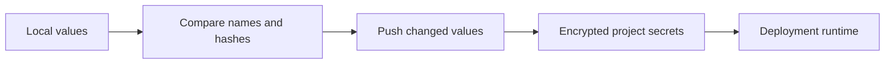

Pxxl encrypts every value. List calls return names and metadata, not secret values. For how variables reach your app, see [environment variables](/deploy/environment-variables).



## Variable input

<ParamField body="projectId" type="string" required>
  Project receiving the variables.
</ParamField>

<ParamField body="vars" type="array" required>
  Array of variable objects.
</ParamField>

<ParamField body="vars[].key" type="string" required>
  Variable name. It must start with a letter or underscore and contain only letters, numbers, and underscores.
</ParamField>

<ParamField body="vars[].value" type="string" required>
  Value encrypted by Pxxl.
</ParamField>

<ParamField body="vars[].isSecret" type="boolean" default="false">
  Marks the value as sensitive.
</ParamField>

<ParamField body="global" type="boolean" default="false">
  Writes to the project's global variables instead of its own.
</ParamField>

<ParamField body="replace" type="boolean" default="false">
  Replaces the stored set with `vars` instead of merging.
</ParamField>

## Compare variables

<Tabs>
  <Tab title="Node.js">
    ```ts
    const vars = [
      { key: "API_URL", value: "https://api.example.com", isSecret: false },
      { key: "API_TOKEN", value: process.env.API_TOKEN!, isSecret: true },
    ];

    const diff = await pxxl.env.diff("proj_123", vars);
    ```
  </Tab>
  <Tab title="Go">
    ```go
    input := map[string]any{"vars": []map[string]any{
      {"key": "API_URL", "value": "https://api.example.com", "isSecret": false},
    }}
    diff, err := client.DiffProjectEnv(ctx, "proj_123", false, input)
    ```
  </Tab>
  <Tab title="Python">
    ```python
    values = {"vars": [
        {"key": "API_URL", "value": "https://api.example.com", "isSecret": False}
    ]}
    diff = client.diff_project_env("proj_123", values)
    ```
  </Tab>
  <Tab title="Rust">
    ```rust
    let values = json!({"vars": [
        {"key": "API_URL", "value": "https://api.example.com", "isSecret": false}
    ]});
    let diff = client.diff_project_env("proj_123", false, values).await?;
    ```
  </Tab>
</Tabs>

**Returns**

```json
{
  "success": true,
  "projectId": "proj_123",
  "scope": "project",
  "counts": { "same": 1, "changed": 1, "missingRemote": 0, "missingLocal": 0 },
  "diff": [
    {
      "key": "API_TOKEN",
      "status": "changed",
      "local": true,
      "remote": true,
      "same": false,
      "localHash": "sha256:...",
      "remoteHash": "sha256:..."
    }
  ]
}
```

Each row's `status` is `same`, `changed`, `missing_remote`, or `missing_local`.

## Push variables

<Tabs>
  <Tab title="Node.js">
    ```ts
    const result = await pxxl.env.push("proj_123", vars, { replace: false });
    ```
  </Tab>
  <Tab title="Go">
    ```go
    input["replace"] = false
    result, err := client.PushProjectEnv(ctx, "proj_123", false, input)
    ```
  </Tab>
  <Tab title="Python">
    ```python
    result = client.push_project_env("proj_123", values, replace=False)
    ```
  </Tab>
  <Tab title="Rust">
    ```rust
    let result = client.push_project_env("proj_123", false, values).await?;
    ```
  </Tab>
</Tabs>

In Go and Rust, put `replace` inside the input object. Python takes `global_=True` and `replace=True` as keyword arguments.

```json
{
  "success": true,
  "message": "Bulk environment variables processed",
  "replaced": false,
  "data": [
    { "key": "API_URL", "isSecret": false }
  ]
}
```

<Warning>
  `replace: true` removes stored variables that are not in `vars`. Run a diff first.
</Warning>

## Environment operations

| Operation | Node.js | Parameters | Returns |
| --- | --- | --- | --- |
| List | `env.list(projectId, options?)` | `global?` | Variable names and metadata |
| Diff | `env.diff(projectId, vars, options?)` | `vars`, `global?` | Diff object shown above |
| Push | `env.push(projectId, vars, options?)` | `vars`, `global?`, `replace?` | Push result shown above |
| Add one | `env.add(projectId, input)` | `key`, `value`, `secret?` | Created variable |
| Update one | `env.update(projectId, input)` | `key`, `value`, `secret?` | Updated variable |
| Remove one | `env.remove(projectId, key)` | Variable name | Action result |
| Reveal | `env.reveal(projectId, key)` | Variable name | The stored value, secrets included |
| History | `env.history(projectId)` | Project ID | Change history |

`env.add()` stores the value as a secret unless you pass `secret: false`. `env.reveal()` needs a read-and-write API key.

```ts
await pxxl.env.add("proj_123", { key: "STRIPE_KEY", value: process.env.STRIPE_KEY! });
const revealed = await pxxl.env.reveal("proj_123", "STRIPE_KEY");
```

`pxxl.environments` is the same object as `pxxl.env`.

| Operation | Go | Python | Rust |
| --- | --- | --- | --- |
| List | `ListProjectEnv(ctx, id, global)` | `list_project_env(id, global_=False)` | `list_project_env(id, global)` |
| Diff | `DiffProjectEnv(ctx, id, global, input)` | `diff_project_env(id, values, global_=False)` | `diff_project_env(id, global, input)` |
| Push | `PushProjectEnv(ctx, id, global, input)` | `push_project_env(id, values, global_=False, replace=False)` | `push_project_env(id, global, input)` |

Adding, editing, revealing, and removing single variables is in Node.js only.
