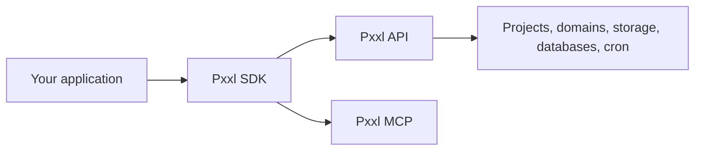

Pxxl has SDKs for Node.js, Go, Python, and Rust. They cover projects, deployments, environment variables, domains, billing, CDN, Storage, databases, cron jobs, analytics, teams, and MCP.

The Node.js SDK covers the most ground. It also manages [servers you link](/integrations/sdk/servers-tools), [tunnels](/tools/tunnels), and [webhook endpoints](/tools/webhooks), and it ships the `pxxl` command-line tool. Go, Python, and Rust cover the core platform calls, and each has a [raw request method](/integrations/sdk/errors-raw-requests) for anything else.

<CardGroup cols={3}>
  <Card title="S3-compatible storage" href="/integrations/sdk/cdn-storage">
    Upload and download objects with a bucket access key and secret key.
  </Card>
  <Card title="Domain checkout" href="/integrations/sdk/domains-billing">
    Buy domains and get a hosted payment link in one call.
  </Card>
  <Card title="Plan gates" href="/integrations/sdk/response-patterns">
    Handle plan limits with structured error fields.
  </Card>
</CardGroup>



## Install

<Tabs>
  <Tab title="Node.js">
    ```bash
    npm install @pxxlapp/pxxl
    ```
  </Tab>
  <Tab title="Go">
    ```bash
    go get github.com/pxxlspace/pxxlspace/sdks/go/pxxl@latest
    ```
  </Tab>
  <Tab title="Python">
    ```bash
    pip install pxxl
    ```
    Python 3.9 or later.
  </Tab>
  <Tab title="Rust">
    ```bash
    cargo add pxxl
    ```
  </Tab>
</Tabs>

## Create a client

<Tabs>
  <Tab title="Node.js">
    ```ts
    import { Pxxl } from "@pxxlapp/pxxl";

    const pxxl = new Pxxl({
      apiKey: process.env.PXXL_API_KEY,
      teamId: process.env.PXXL_TEAM_ID,
    });
    ```
  </Tab>
  <Tab title="Go">
    ```go
    client, err := pxxl.NewClient(os.Getenv("PXXL_API_KEY"))
    if err != nil {
      log.Fatal(err)
    }
    ```
  </Tab>
  <Tab title="Python">
    ```python
    import os
    from pxxl import PxxlClient

    client = PxxlClient(
        api_key=os.environ["PXXL_API_KEY"],
        team_id=os.getenv("PXXL_TEAM_ID"),
    )
    ```
  </Tab>
  <Tab title="Rust">
    ```rust
    use pxxl::PxxlClient;

    let client = PxxlClient::new(std::env::var("PXXL_API_KEY")?)?
        .with_team_id(std::env::var("PXXL_TEAM_ID").unwrap_or_default());
    ```
  </Tab>
</Tabs>

The SDKs do not read `PXXL_API_KEY` on their own. Pass the key when you create the client. See [authentication](/integrations/sdk/authentication) for every client option.

In Node.js, `Pxxl` groups methods by resource, such as `pxxl.storage.createBucket()`. `PxxlClient` is also exported. It has the same calls as flat methods, such as `createStorageBucket()`, and `Pxxl` extends it, so both styles work on one client.

<Note>
  Keep API keys on the server. Do not expose them in browser code.
</Note>
