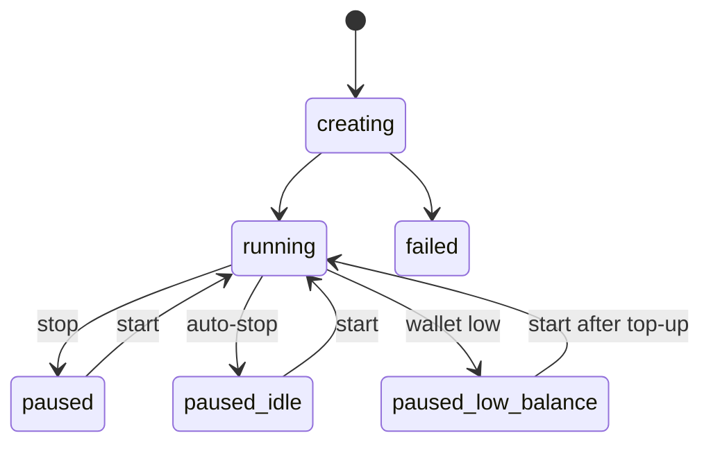

A sandbox is an isolated Linux workspace you can create in seconds, run commands in, read and write files in, and throw away. Use one to run code an AI agent wrote, try a repository, run tests, or share a live preview.

Each sandbox has:

- A persistent `/workspace` directory that survives pauses.
- A public preview URL, `https://<domain>`, for the app listening on `$PORT` (3000) inside the sandbox.
- Commands, files, and an interactive terminal from the [API](/integrations/api/sandboxes), the [SDKs](/integrations/sdk/sandboxes), the [CLI](/sandboxes/cli), and the dashboard.

<Note>
  The preview URL is public. Anyone with the link can open the app on `$PORT`. Don't serve secrets from it.
</Note>

## Pricing

You pay for the CPU and memory a sandbox has while it runs, **billed per second** from your USD wallet.

| Resource | Price |
| --- | --- |
| vCPU | $0.012 per vCPU-hour |
| Memory | $0.006 per GB-hour |
| Disk | 10 GB included. Choose 2, 5, or 10 GB. |
| Paused or stopped | $0. `/workspace` is kept. |

| Size | vCPU | Memory | Per hour | 8 hours a day for 30 days |
| --- | --- | --- | --- | --- |
| `micro` | 1 | 1 GB | $0.018 | $4.32 |
| `small` | 2 | 4 GB | $0.048 | $11.52 |
| `medium` | 4 | 8 GB | $0.096 | $23.04 |
| `large` | 8 | 16 GB | $0.192 | $46.08 |

Rates can change. `GET /sandboxes/pricing` and `pxxl sandbox pricing` always return the current ones.

Starting a sandbox needs at least **$0.25** in your [wallet](/account/wallet). If the wallet runs low while a sandbox is running, Pxxl pauses it (status `paused_low_balance`) instead of letting the balance go negative. Top up and start it again.

## Plans and limits

Sandboxes are on Plus, Pro, and Enterprise.

| Plan | Running at once | Total | Largest sandbox |
| --- | --- | --- | --- |
| Plus | 3 | 10 | 4 vCPU, 8 GB |
| Pro | 10 | 25 | 8 vCPU, 16 GB |
| Enterprise | 50 | 100 | 8 vCPU, 16 GB |

Paused sandboxes count toward the total but not toward the running limit.

## Templates

| Template | What's in it |
| --- | --- |
| `base` | A Linux shell with common tools. The default. |
| `node` | Node.js and npm. |
| `python` | Python and pip. |
| `html` | A static site served on `$PORT`. |
| `php` | PHP. |

Pass `sourceRepository` (`owner/repo`) to clone one of your connected GitHub repositories into `/workspace`.

## Lifecycle

| Status | Meaning | Billed |
| --- | --- | --- |
| `creating` | Pxxl is placing and starting the sandbox. | No |
| `running` | Ready for commands, files, and previews. | Yes |
| `paused` | You stopped it. | No |
| `paused_idle` | Auto-stop paused it after it was idle. | No |
| `paused_low_balance` | Your wallet ran low. | No |
| `failed` | It couldn't start. Check its logs. | No |

Older sandboxes may report `stopped` or `paused_insufficient_points`. Treat both as paused.

### Auto-stop

Every sandbox pauses itself after it's idle for `autoStopMinutes` (default 60, up to 1440). Set it to `0` to never pause on idle. Change it any time with `PATCH /sandboxes/{id}`, `sandbox.setAutoStop(minutes)`, or `pxxl sandbox update <id> --auto-stop <minutes>`.

## Commands and files

- `exec` runs a shell command in `/workspace` (or `workdir`) and returns the exit code and output. A command can run for up to 300 seconds. Ask for `application/x-ndjson` to stream output as it's produced.
- Files are text, up to 2 MB each. List a directory, read a file, or write one.
- The terminal gives you an interactive shell over a WebSocket. It's available when terminals are enabled for your account.

## Next steps

<CardGroup cols={2}>
  <Card title="Quickstart" href="/sandboxes/quickstart">
    Create a sandbox and run a command from code, the CLI, or curl.
  </Card>
  <Card title="API reference" href="/integrations/api/sandboxes">
    Every sandbox endpoint, with request and response shapes.
  </Card>
  <Card title="SDKs" href="/integrations/sdk/sandboxes">
    The `Sandbox` handle in Node.js and Python.
  </Card>
  <Card title="CLI" href="/sandboxes/cli">
    `pxxl sandbox` commands.
  </Card>
</CardGroup>
